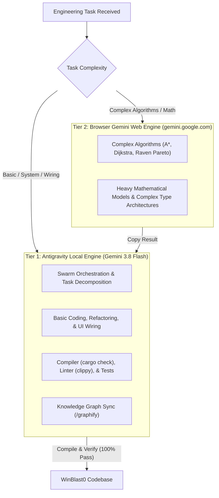

# Dual-Engine Coding & Algorithmic Delegation Protocol

## 1. Objective & Model Specialization
WinBlast0 engineering adheres to a dual-engine workflow partitioning local agent capabilities and cloud-hosted reasoning models:

## 2. Responsibilities by Tier

### Tier 1: Antigravity Gemini 3.8 Flash (Local Agent)
- **Role**: Primary orchestrator, build runner, tester, and implementer.
- **Assigned Tasks**:
  - Swarm coordination (`/swarm`), status tracking, and subagent management.
  - Basic feature implementation, glue code, and UI component construction.
  - Windows API calls, IOCTLs, registry queries, and service management.
  - Verification: `cargo check --all-targets`, `cargo clippy --all-targets -- -D warnings`, and test suites.
  - Knowledge graph maintenance (`/graphify`).

### Tier 2: Browser Gemini Web Engine (gemini.google.com)
- **Role**: Specialist algorithmic consultant and deep reasoning engine.
- **Assigned Tasks**:
  - Complex algorithmic design: graph routing, shortest-path scheduling, multi-criteria Pareto trade-offs.
  - High-performance algorithm generation: zero-allocation state tracking, bitset math, and branchless evaluations.
  - Intricate mathematical optimizations and heuristic formula derivations.

## 3. Delegation & Integration Pipeline
When an agent or swarm worker encounters a complex coding or algorithmic problem:
1. **Formulate Brief**: Create an unambiguous specification containing target function signatures, inputs, outputs, memory/performance constraints, and test scenarios.
2. **Dispatch via Browser Subagent**: Delegate to the browser subagent attached to the active `https://gemini.google.com/app` session.
3. **Capture & Copy Result**: The browser subagent retrieves the complete code response and delivers it back to Tier 1.
4. **Implement & Refactor**: Tier 1 adapts and integrates the code into the local crate modules.
5. **Rigorously Verify**: Tier 1 validates that the integrated code compiles with 0 warnings, passes all unit and integration tests, and is indexed via `/graphify`.
