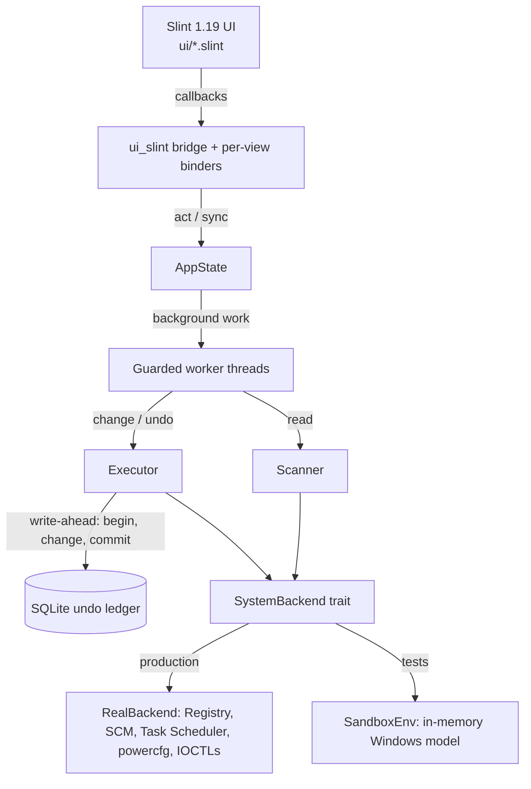

# WinBlast0 — Developer & Architecture Guide

How WinBlast0 is put together, how it is tested and how to add a tweak. For users, see [README.md](README.md).

---

## 🏛️ Architecture



| Path | What lives there |
|---|---|
| `ui/` | Slint markup: `shell/` (window, sidebar, header), `views/` (one file per page or tab), `components/`, `stores/` (globals such as `nav.slint`), `tokens/` (theme), `fonts/` (embedded Inter and JetBrains Mono) |
| `src/ui_slint/` | The bridge between Slint and `AppState`: `bridge.rs` (UI tick, settings, screenshot tour), `shell.rs`, `views/<page>.rs` binders, `i18n.rs` |
| `src/app.rs` | `AppState`, navigation (`ActiveView`, 28 views on 17 pages) and worker events |
| `src/core/` | `SystemBackend` trait with `RealBackend` and `SandboxEnv`, i18n catalogs (`i18n.rs`, `view_i18n.rs`), `process.rs` (`SilentCommand`/`TimedCommand` with timeouts, System32 resolution), `updater.rs` (signed updates), settings, elevation |
| `src/scanner/` | Reads current state for each tweak (registry, services, tasks, AppX, power) |
| `src/executor/` | `engine.rs` (apply, undo, write-ahead, mutation lock), `reg_mutator.rs`, service and power mutators |
| `src/backup/` | `state_ledger.rs` (SQLite ledger, schema v2, crash reconciliation) and restore points |
| `src/hardware/` | CPU, GPU, thermal, disks (`disks.rs` SMART/NVMe, `tbw.rs` SATA unit table), drivers |
| `src/tools/` | Cleaner, AppX, WinGet, startup, repair, network, benchmarks, automation, Windows Setup file |
| `assets/rules/*.toml` | The tweak catalog (230 tweaks), built into the exe |

### Rules that keep it honest
- **No invented values.** If a sensor or API can't be read, show N/A or *Requires admin*. Never derive or hard-code a reading.
- **Write-ahead.** Every system change goes through `begin_change → change → commit_change` in the ledger, with the exact prior value (`RegValuePrior` for registry values).
- **One mutation at a time.** Changes take the global `MUTATION_LOCK` (`mutation_guard()`).
- **External tools** are started with `SilentCommand`, which resolves them in System32 and enforces a timeout.

---

## 🧪 Testing

All default tests run against `SandboxEnv` or read-only APIs; **none of them change the machine they run on.**

```powershell
cargo test --all-targets                      # 321 tests
cargo clippy --all-targets -- -D warnings     # must be clean
cargo clippy --all-targets --features vm-tests -- -D warnings
```

| Suite | Covers |
|---|---|
| `--lib` | Unit tests, including raw SMART hex-dump fixtures in `tests/fixtures/smart/` |
| `tweak_sandbox_e2e` | Apply → scan → re-apply → undo for all 230 tweaks, checked byte-for-byte |
| `fuzz_mutation_properties` | proptest reversibility and idempotence (`PROPTEST_CASES=400` for a deeper run) |
| `edge_cases_unorthodox`, `selection_automation_e2e`, `dual_engine_validation_test` | Edge cases, selection and automation flows |
| `ui_views`, `ui_parity`, `ui_layout_collision`, `nav_labels`, `ui_render_preview` | Headless UI: every view renders, every callback is wired, labels and layout |
| `font_coverage`, `glyph_coverage` | Every UI character exists in the embedded fonts |
| `real_windows_env` | Read-only checks against the real Windows APIs |
| `vm_aggressive` | **VM only** (`--features vm-tests`, `WINBLAST_VM_AGGRESSIVE=1`): real-registry byte-exact round trips, hard-kill crash recovery, concurrency stress, ledger corruption |

### Screenshots
`WINBLAST_SCREENSHOT_DIR=<dir>` makes the app open each view, wait for its read-only data and save it as a BMP, then quit. `WINBLAST_SCREENSHOT_VIEWS=dashboard,matrix,…` picks views; `WINBLAST_SCREENSHOT_WAIT=8` sets the wait in seconds. The tour only navigates and never presses a button.

---

## ➕ Adding a New Declarative Tweak

All tweaks are defined declaratively in TOML files under `assets/rules/`. A tweak definition requires:

```toml
[[tweaks]]
id = "custom_tweak_identifier"
name = "Disable Unwanted Feature"
description = "Disables background data indexing to reduce idle CPU cycles."
category = "OS Settings"
sub_category = "Performance"
risk = "Safe"
min_build = 19041
max_build = 0

[[tweaks.actions]]
type = "RegistryDword"
root = "HKLM"
path = "SOFTWARE\\Policies\\Microsoft\\Windows\\Example"
value_name = "DisableFeature"
target_data = 1
default_data = 0
```

### Checklist for Adding Tweaks:
1. **Catalog Integrity**: Ensure `id` is unique and matches UUID format or snake_case format.
2. **Build Guards**: Specify `min_build` or `max_build` if the tweak is exclusive to Windows 10 or Windows 11.
3. **Vendor Guards**: For GPU tweaks, specify `gpu_vendor = "NVIDIA"` (or `"AMD"`, `"Intel"`).
4. **Localization**: Register translations for the new tweak ID in `src/core/tweak_i18n/` across all supported languages.
5. **Validation**: Run `cargo test --test tweak_sandbox_e2e` to verify parsing and execution in the sandbox.

---

## 🛡️ Coding & Safety Guidelines

- **No Console Flashing**: Never spawn naked `std::process::Command` calls. Always use `SilentCommand` with `CREATE_NO_WINDOW` (`0x08000000`).
- **Command Injection Prevention**: Always escape and quote parameters passed to PowerShell or shell commands. Never interpolate unvalidated user or network inputs into execution strings; parse network targets with `std::net::IpAddr` before dispatching.
- **Strict Pointer Provenance & Safe Win32 FFI**: Use `MaybeUninit::zeroed()` for C structs; avoid uninitialized field mutations or unsound enum transmutes. Always wrap OS handles (`HANDLE`, `SC_HANDLE`, COM pointers) with RAII drop guards.
- **Graceful UAC Cancellation**: When calling `ShellExecuteW(..., "runas", ...)`, verify return codes (> 32); never terminate the application abruptly if the user cancels UAC consent.
- **Transactional Rollback**: Ensure every action implements a valid revert path recorded in `StateLedger`.
- **Windows FFI Bindings Lock**: Keep `windows = "0.62"` and `windows-core = "0.62"` locked to match the vendored `rune-framework` Win32 bindings.
- **String Hygiene**: Avoid hardcoding UI strings. Use `TextKey` and `s.tr()` or `s.tweak_title()`.
- **Thread Safety**: Never block the main Rune UI thread with heavy I/O or network calls. Dispatch via `spawn_guarded_worker`.
