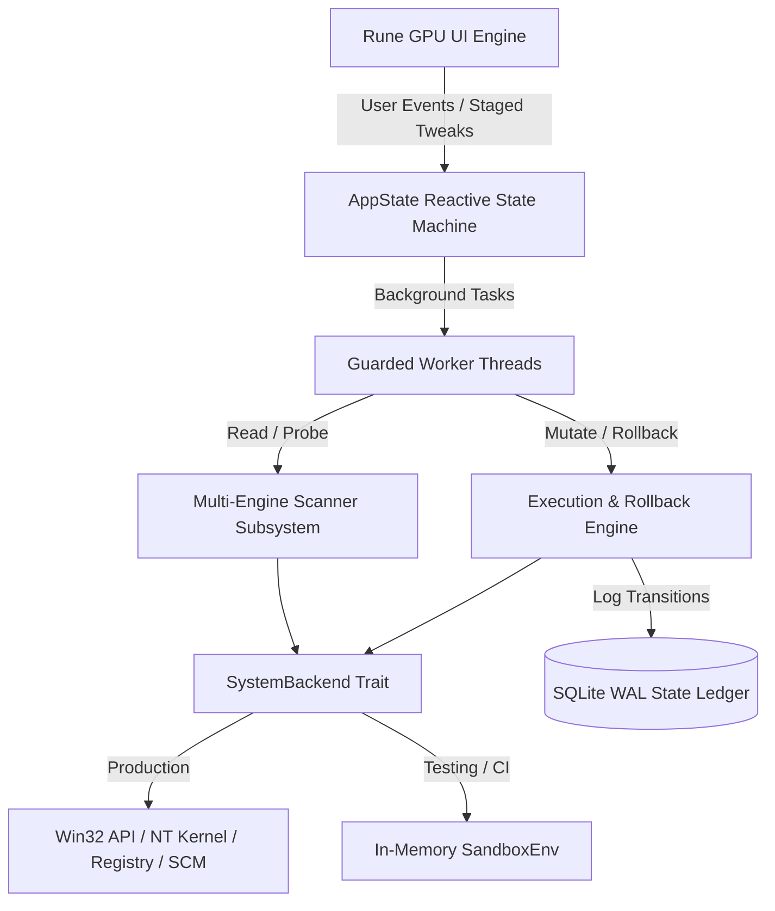

# WinBlast Optimizer — Developer & Architecture Guide

Welcome to the internal engineering guide for **WinBlast Optimizer**. This document explains the system design, code layout, sandbox testing environment, and guidelines for adding new tweaks and features.

---

## 🏛️ System Architecture



### Key Subsystems:
1. **`src/ui/`**: Pure-Rust Rune immediate-mode GUI engine with dynamic responsive tiering, 60 FPS spring animations, theme styling, and palette-driven scroll bars (`widgets/scrollbar.rs`).
2. **`src/core/`**: Core definitions, OS version detection, elevation token verification, internationalization (`i18n.rs` & `tweak_i18n/`), and the `SystemBackend` abstraction.
3. **`src/scanner/`**: Detection engines for 64-bit/32-bit Registry values, Win32 SCM services, scheduled tasks, and provisioned AppX packages.
4. **`src/executor/`**: Transactional mutators for registry keys, Windows services, hosts blocking, and power scheme parameters.
5. **`src/backup/`**: SQLite Write-Ahead Logging (`winblast0_ledger.db`) transaction engine and Windows VSS Restore Point manager.
6. **`src/hardware/`**: NT kernel timer resolution FFI, CPU core topology (`GetLogicalProcessorInformationEx`), core parking manager, and DXGI/SetupDi GPU vendor detection.
7. **`src/tools/`**: System tools including the Junk File & Recycle Bin cleaner, AppX deprovisioner, WinGet integration, startup manager, and `autounattend.xml` generator.

---

## 🧪 Testing with `SystemBackend` & `SandboxEnv`

WinBlast uses the object-safe `SystemBackend` trait to separate optimization logic from live Windows APIs. This allows 100% test coverage without mutating the host machine's registry:

```rust
pub trait SystemBackend: Send + Sync {
    fn read_registry_dword(&self, root: RegRoot, path: &str, value: &str) -> Result<Option<u32>>;
    fn write_registry_dword(&self, root: RegRoot, path: &str, value: &str, data: u32) -> Result<()>;
    fn query_service_status(&self, name: &str) -> Result<Option<ServiceStatus>>;
    fn set_service_startup(&self, name: &str, mode: ServiceStartMode) -> Result<()>;
    // ...
}
```

### Running Tests:
```powershell
# Run all unit tests (109 tests)
cargo test --lib

# Run isolated sandbox regression tests (25 tests)
cargo test --test tweak_sandbox_e2e

# Run headless UI responsive matrix & multi-locale sweeps (13 tests)
cargo test --test ui_responsive_e2e

# Run headless scroll-bar geometry, hover & drag interaction E2E tests (5 tests)
cargo test --test ui_scrollbar_test

# Run live Windows environment read-only audit (3 tests)
cargo test --test real_windows_env
```

---

## ➕ Adding a New Declarative Tweak

All tweaks are defined declaratively in TOML files under `assets/rules/`. A tweak definition requires:

```toml
[[tweaks]]
id = "custom_tweak_identifier"
name = "Disable Unwanted Feature"
description = "Disables background data indexing to reduce idle CPU cycles."
category = "OS Settings"
sub_category = "Performance"
risk = "Safe"
min_build = 19041
max_build = 0

[[tweaks.actions]]
type = "RegistryDword"
root = "HKLM"
path = "SOFTWARE\\Policies\\Microsoft\\Windows\\Example"
value_name = "DisableFeature"
target_data = 1
default_data = 0
```

### Checklist for Adding Tweaks:
1. **Catalog Integrity**: Ensure `id` is unique and matches UUID format or snake_case format.
2. **Build Guards**: Specify `min_build` or `max_build` if the tweak is exclusive to Windows 10 or Windows 11.
3. **Vendor Guards**: For GPU tweaks, specify `gpu_vendor = "NVIDIA"` (or `"AMD"`, `"Intel"`).
4. **Localization**: Register translations for the new tweak ID in `src/core/tweak_i18n/` across all supported languages.
5. **Validation**: Run `cargo test --test tweak_sandbox_e2e` to verify parsing and execution in the sandbox.

---

## 🛡️ Coding & Safety Guidelines

- **No Console Flashing**: Never spawn naked `std::process::Command` calls. Always use `SilentCommand` with `CREATE_NO_WINDOW` (`0x08000000`).
- **Command Injection Prevention**: Always escape and quote parameters passed to PowerShell or shell commands. Never interpolate unvalidated user or network inputs into execution strings; parse network targets with `std::net::IpAddr` before dispatching.
- **Strict Pointer Provenance & Safe Win32 FFI**: Use `MaybeUninit::zeroed()` for C structs; avoid uninitialized field mutations or unsound enum transmutes. Always wrap OS handles (`HANDLE`, `SC_HANDLE`, COM pointers) with RAII drop guards.
- **Graceful UAC Cancellation**: When calling `ShellExecuteW(..., "runas", ...)`, verify return codes (> 32); never terminate the application abruptly if the user cancels UAC consent.
- **Transactional Rollback**: Ensure every action implements a valid revert path recorded in `StateLedger`.
- **Windows FFI Bindings Lock**: Keep `windows = "0.62"` and `windows-core = "0.62"` locked to match the vendored `rune-framework` Win32 bindings.
- **String Hygiene**: Avoid hardcoding UI strings. Use `TextKey` and `s.tr()` or `s.tweak_title()`.
- **Thread Safety**: Never block the main Rune UI thread with heavy I/O or network calls. Dispatch via `spawn_guarded_worker`.
