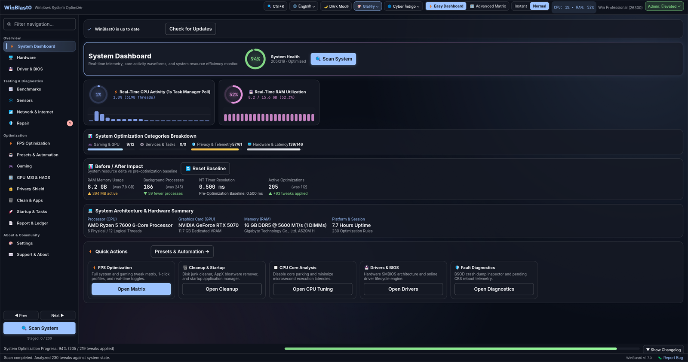
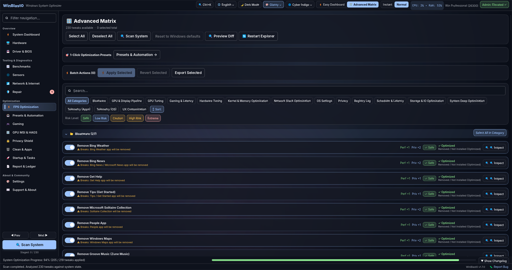
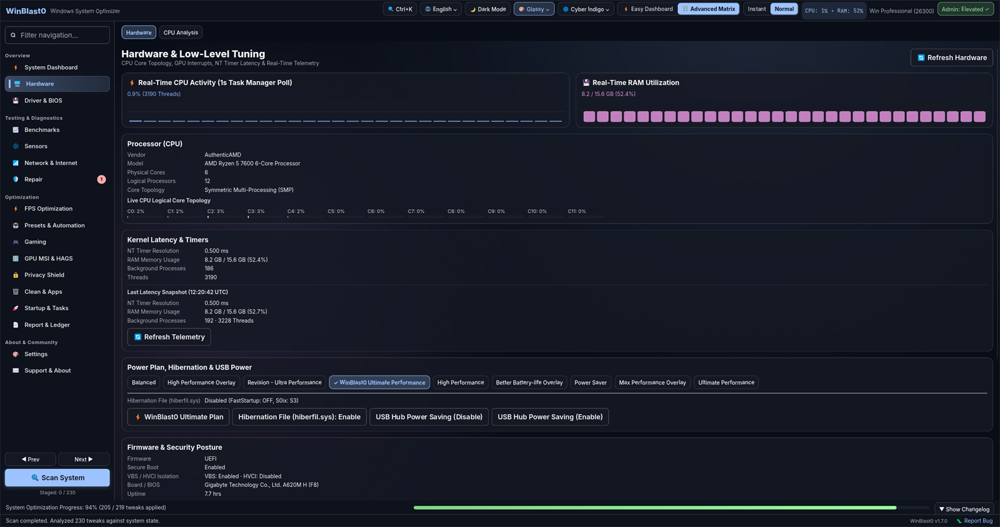
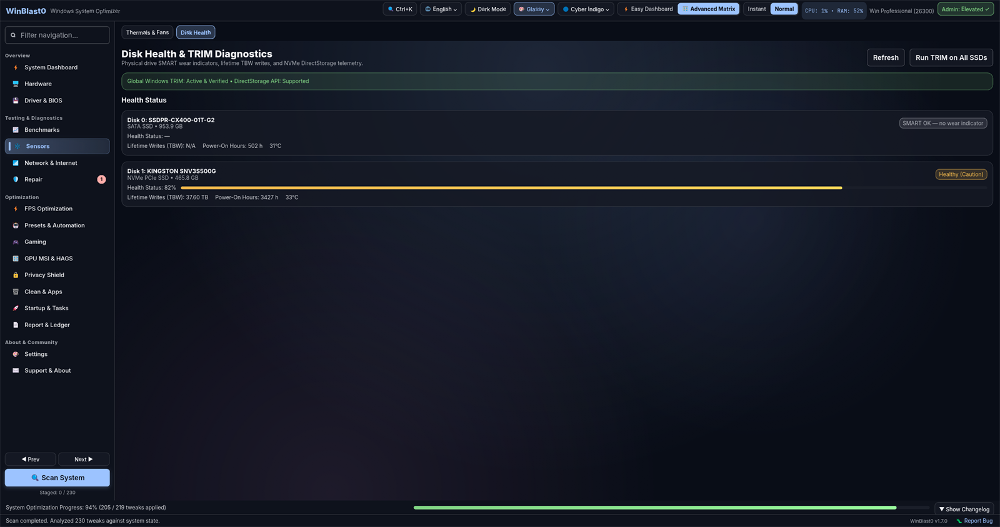
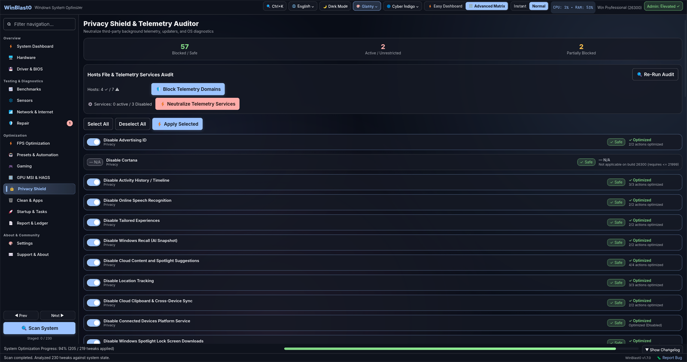
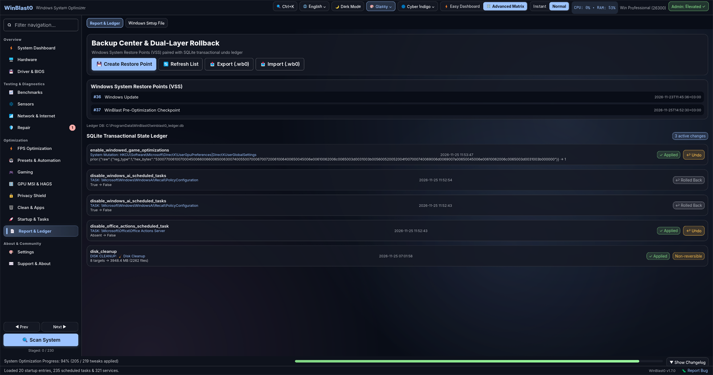
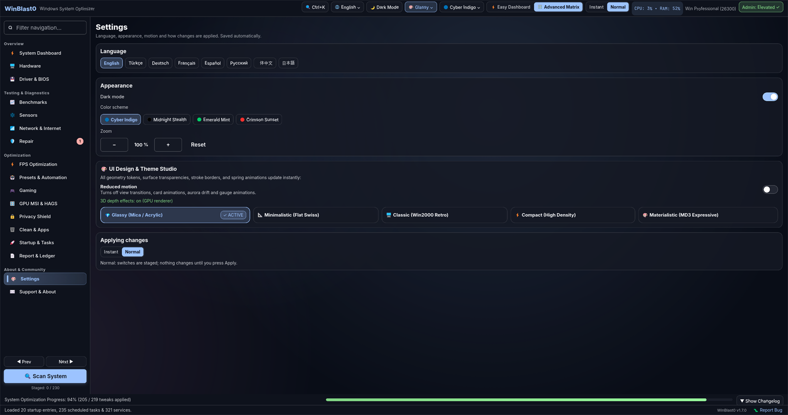

<div align="center">


# WinBlast0

**A Windows optimizer that measures before it changes anything, and can undo everything it changes.**

[](https://github.com/Konstrukturmx/WinBlast-Optimizer/releases/latest)
[](https://www.virustotal.com/gui/file/a31d6712a830d929ef50bac754b751c5d5d58df2646732a08685acd7945bbb1a)
[](#-prerequisites)
[](#-build-from-source)
[](LICENSE)

[**⬇ Download v1.7.0**](https://github.com/Konstrukturmx/WinBlast-Optimizer/releases/latest) &nbsp;·&nbsp; [What's new](#-whats-new-in-170) &nbsp;·&nbsp; [Prerequisites](#-prerequisites) &nbsp;·&nbsp; [Changelog](CHANGELOG.md) &nbsp;·&nbsp; [Security](SECURITY.md)

<br/>



<sub>Screenshots are from a real PC (Ryzen 5 7600, RTX 5070, Windows 11 build 26300). Nothing in them is simulated.</sub>

</div>

---

## ✨ Why WinBlast0

<table>
<tr>
<td width="33%" valign="top">

### ↩️ Undo you can trust
Every change is written to a local SQLite ledger **before** it is made, with the exact previous registry type and bytes. Undo restores *your* value, not a guess. A crash or power cut mid-apply is recovered at the next start.

</td>
<td width="33%" valign="top">

### 📏 Only real data
Temperatures, disk wear, TBW, latency and benchmarks come from the hardware and Windows APIs. When a value can't be read, WinBlast0 says **N/A** or **Requires admin**, never a made-up number.

</td>
<td width="33%" valign="top">

### 🎛️ 230 audited tweaks
Privacy, telemetry, gaming, latency, power, network, storage and UI tweaks. Each one shows its risk level, what it breaks and its current state before you apply it.

</td>
</tr>
<tr>
<td valign="top">

### 🔒 Locked down
The tweak catalog is built into the signed exe. Updates are HTTPS-only and install only if signed by the release certificate. Windows tools run from System32 by full path.

</td>
<td valign="top">

### 💽 Disk health that works
NVMe SMART log page and a vendor-unit table for SATA SSDs give real health %, lifetime writes, power-on hours and temperature.

</td>
<td valign="top">

### 🌍 8 languages, 17 pages
English, Türkçe, Deutsch, Français, Español, Русский, 简体中文 and 日本語. Dark/light, 4 colour schemes, 5 styles, zoom and a Reduced motion switch.

</td>
</tr>
</table>

---

## 📸 Tour

<table>
<tr>
<td width="50%"><p align="center"><b>Tweaks</b>: 230 tweaks with risk levels, live status and Inspect</p></td>
<td width="50%"><p align="center"><b>Hardware</b>: CPU topology, timers, power plans, firmware and security</p></td>
</tr>
<tr>
<td><p align="center"><b>Disk health</b>: real SMART wear, TBW and power-on hours</p></td>
<td><p align="center"><b>Privacy Shield</b>: telemetry audit and hosts blocking</p></td>
</tr>
<tr>
<td><p align="center"><b>Backup & Undo</b>: restore points plus a per-change undo ledger</p></td>
<td><p align="center"><b>Settings</b>: language, look, zoom, motion and apply mode</p></td>
</tr>
</table>

---

## 🆕 What's new in 1.7.0

- **Write-ahead undo ledger**: a change is recorded before it is made. In VM tests, 6 of 6 hard kills mid-apply recovered exactly, and 420 round trips with text, QWORD and binary values came back byte-for-byte.
- **Undo restores your previous values.** "Reset to Windows defaults" is a separate, confirmed button.
- **Security hardening**: built-in catalog only, signed-and-pinned updates, System32 tool paths, an atomic hosts file and a temp cleaner that no longer runs as SYSTEM.
- **Fake numbers removed**: no derived temperatures, fan RPM, fixed RAM latency, invented disk speeds or FPS tables. Pages show "Not scanned yet" until they have data.
- **NVMe SMART fixed**: the log-page query was wrong since the first version. A Kingston NVMe now shows 82 % / 37.6 TB written instead of 99 % / 0.10 TB.
- **26 pages → 17**, with tabs, a new Settings page and two-click confirmation on system-changing buttons.
- Slint 1.19 UI with embedded Inter and JetBrains Mono fonts, and a statically linked C runtime.

The full list is in the [changelog](CHANGELOG.md).

---

## 📋 Prerequisites

| | Requirement | Notes |
|---|---|---|
| 🪟 | **Windows 10 22H2 or Windows 11, 64-bit** | Tested on Windows 10 19045 (Hyper-V VM) and Windows 11 26300. Tweaks that don't apply to your build are marked *N/A*. |
| 🛡️ | **Administrator account** | Needed to change system settings and to read SMART data. Without admin rights WinBlast0 opens in inspection mode and shows *Requires admin*. |
| 🎨 | **Any GPU with DirectX 12 / Vulkan** *(optional)* | Used for smooth rendering. It also runs without a GPU (VMs, Remote Desktop) using software rendering. |
| 🧩 | **Nothing else to install** | Single portable `.exe`; the C runtime is linked in. PowerShell 5.1, `powercfg`, `schtasks` and `curl` ship with Windows. |
| 🌐 | **Internet** *(optional)* | Only for the update check, DNS ping tests and the WinGet installer tab (needs [WinGet](https://learn.microsoft.com/windows/package-manager/winget/)). |

> **About the signature.** `winblast0.exe` is Authenticode-signed with the project's own *self-signed* certificate (thumbprint `070A70E017B5BB8F7A345688C82D8A578DAC404D`) and a DigiCert timestamp. Windows SmartScreen may say *"Windows protected your PC / Unknown publisher"* the first time; choose **More info → Run anyway**. Always check the SHA-256 against the release page.

---

## 🚀 Getting started

1. Download **`winblast0.exe`** from the [latest release](https://github.com/Konstrukturmx/WinBlast-Optimizer/releases/latest).
2. Verify it (PowerShell):
   ```powershell
   (Get-FileHash .\winblast0.exe -Algorithm SHA256).Hash   # compare with winblast0.exe.sha256
   Get-AuthenticodeSignature .\winblast0.exe | Format-List SignerCertificate, TimeStamperCertificate
   ```
3. Run it. Accept the UAC prompt for full functionality.
4. Press **Scan System**. Nothing changes until you apply something; in *Normal* mode switches are staged until you press **Apply**.
5. Before larger changes, use **Backup & Undo → Create Restore Point**. Every applied tweak can be undone there or from its own row.

WinBlast0 keeps its data in `C:\ProgramData\WinBlast0` (undo ledger, update staging) and your settings in `%APPDATA%`. Delete the exe and those folders to remove it; undo your changes first if you want them reverted.

---

## 🛠️ Build from source

```powershell
# Requirements: Rust (stable, MSVC toolchain) + Visual Studio Build Tools with the Windows SDK
git clone https://github.com/Konstrukturmx/WinBlast-Optimizer.git
cd WinBlast-Optimizer
cargo build --release          # target\release\winblast0.exe
cargo test --all-targets       # 321 tests, none of them change your system
```

- Tests run against `SandboxEnv`, an in-memory Windows model. Tests that change a real system are behind `--features vm-tests` and run only in a disposable VM.
- `cargo clippy --all-targets -- -D warnings` must stay clean.
- Architecture, conventions and how to add a tweak: [DEVELOPMENT.md](DEVELOPMENT.md).

---

## 🔐 Security & privacy

- No telemetry, no accounts, no analytics. The only network calls are the ones listed under Prerequisites.
- Updates come only from this repository's releases, over HTTPS, and must be signed by the release certificate.
- Report vulnerabilities privately as described in [SECURITY.md](SECURITY.md).

---

## 📜 License & credits

WinBlast0 is released under the [MIT License](LICENSE).
UI built with [Slint](https://slint.dev) under the Slint Royalty-Free Desktop License. Fonts: [Inter](https://rsms.me/inter/) and [JetBrains Mono](https://www.jetbrains.com/lp/mono/) (SIL OFL 1.1, see `ui/fonts/`). SATA wear-attribute units follow the [smartmontools](https://www.smartmontools.org/) drive database.

<div align="center"><sub>Use at your own risk: back up and create a restore point before making system changes.</sub></div>
