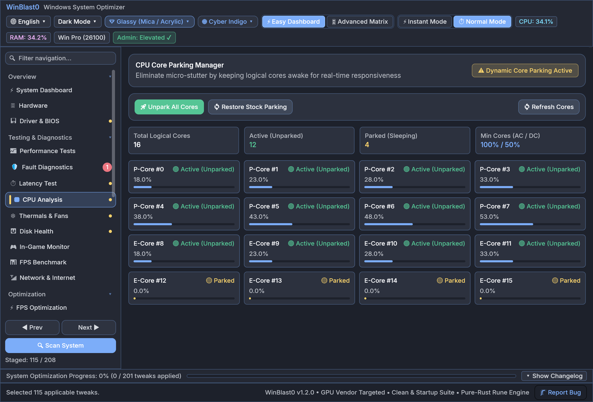
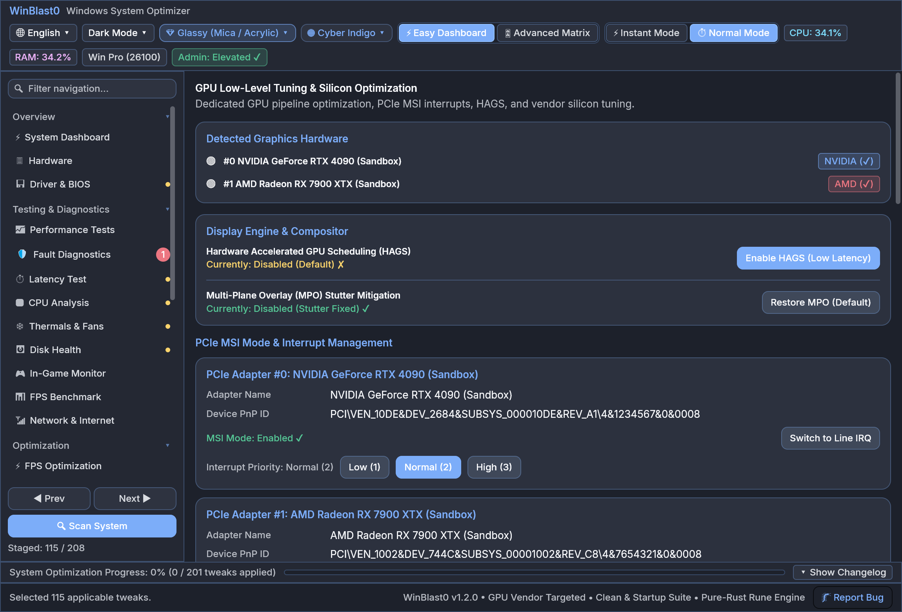

<div align="center">

# ⚡ WinBlast Optimizer

### Next-Generation, Pure-Rust Windows System Optimizer & Hardware Latency Engine

[](https://github.com/Konstrukturmx/WinBlast-Optimizer/releases/latest)
[-brightgreen?style=for-the-badge&logo=virustotal)](https://www.virustotal.com/gui/file/19895c54d3699391aebedb5c3e384aeb7ac5a73f8d1bee9ff7da4cd623d2fa00)
[](LICENSE)
[-0078D6?style=for-the-badge&logo=windows)](https://github.com/Konstrukturmx/WinBlast-Optimizer)
[](https://www.rust-lang.org/)
[-success?style=for-the-badge)](tests/)
[-orange?style=for-the-badge)](src/core/i18n.rs)

<p align="center">
  <b>WinBlast Optimizer</b> is a standalone, lightweight, zero-dependency Windows optimization suite designed for performance enthusiasts, competitive gamers, power users, and system administrators. Built in pure Rust with direct Win32/NT kernel bindings, it replaces bloated PowerShell scripts and black-box tweakers with an auditable, transactional, and fully reversible optimization engine.
</p>

[**Download Latest Release (v1.2.0)**](https://github.com/Konstrukturmx/WinBlast-Optimizer/releases/latest) • [**Changelog**](CHANGELOG.md) • [**Architecture Guide**](DEVELOPMENT.md) • [**VirusTotal Report**](https://www.virustotal.com/gui/file/19895c54d3699391aebedb5c3e384aeb7ac5a73f8d1bee9ff7da4cd623d2fa00) • [**Knowledge Graph**](graphify-out/graph.html)

---

</div>

## 📸 Interface Preview

<div align="center">

### 🚀 Easy Dashboard (One-Click Profiles & Live Hardware Telemetry)


<br/><br/>

### 🎛️ Advanced Optimization Matrix (208 Curated Tweaks)


<br/><br/>

### ⚡ CPU Core Parking & Hybrid Architecture Visualizer


<br/><br/>

### 🎮 GPU Silicon Tuning & Hardware Vendor Gating


</div>

---

## 🌟 Key Architecture & Capabilities

Derived from the formal [**WinBlast0 Technical Knowledge Base**](WinBlast0/00%20-%20Index%20(MOC).md), WinBlast Optimizer is engineered with four fundamental pillars:

### 1. 🦀 Pure-Rust Rune Engine & 5 Full UI Themes
* **GPU-Accelerated Rendering**: Custom immediate-mode Rune GUI with hardware V-Sync synchronization and fluid 60 FPS spring animations.
* **5 Distinct UI Theme Styles**: Full design layout, typography weights, corner radii, borders, and spring animations:
  * **💎 Glassy (Mica / Acrylic)**: Translucent frosted glass fills, luminous glow borders (`border_accent`), 12px pill radiuses, and bouncy spring motion.
  * **📐 Minimalistic (Flat Swiss)**: Razor-sharp 1px monochromatic borders, zero elevation, 0px card radius, and instantaneous transitions.
  * **🖥️ Classic (Win2000 Retro)**: Workstation aesthetic with 2px beveled borders, tactile snap animations, and high functional density.
  * **⚡ Compact (High Density)**: Micro-padding (8px), 4px corners, 180px sidebar, maximized information per square inch.
  * **🎨 Materialistic (Material Design 3)**: Soft 18px rounded cards, 24px pill buttons, tonal surfaces, and smooth decelerated spring motion.
* **4 WCAG AA Color Schemes**: *Cyber Indigo*, *Midnight Stealth*, *Emerald Mint*, and *Crimson Sunset* with Dark and Light mode support.
* **Permanent High-Resolution Icon**: Embedded `winblast.ico` with full PE Version Information (`Konstrukturmx`, `WinBlast Optimizer`, version `1.2.0.0`).
* **Themed Always-On Scroll Bars**: Every overflowing viewport renders a custom palette-driven scroll bar (6 pt muted thumb at rest, 9 pt theme-accent thumb on hover/drag) with dedicated `14.0pt` to `16.0pt` right gutters preventing thumb-button collisions.

### 2. ⚡ Autonomous Self-Updater & Game Platform Engine (v1.2)
* **GitHub Releases Self-Updater**: Zero-dependency HTTPS release checker querying official releases with semver comparison. Performs atomic in-place executable replacement (`.old` swap) and automatic restart without external updaters.
* **Administrator Elevation Guard**: Pre-flight Win32 `TokenElevation` audit with non-intrusive warning banners and one-click UAC relaunch via `ShellExecuteW("runas")`.
* **Game Prerequisites & Runtimes Cascade Engine**: Audits, verifies, and installs essential gaming runtimes (DirectX, Visual C++ 2005–2022 All-in-One, Vulkan, .NET Desktop Runtime 8.0/9.0, OpenAL, XNA) via a resilient 3-tier cascade: WinGet silent install ➔ Chocolatey CLI fallback ➔ Direct vendor portal launch.
* **Unified Gaming & Performance Hub**: Consolidated 5-tab high-density workspace integrating Live Frametime/Jitter Monitor, FPS Benchmark, IFEO Game Profiles, In-Game HUD toggles, and Esports Hardware Suitability into a unified cockpit.
* **Multi-Axis Sorting Engine**: Dynamic 1-click sorting across the Advanced Matrix, Clean & Apps, Startup & Tasks, Driver Lifecycle, and Game Prerequisites.
* **Driver & SMBIOS Diagnostics**: Direct SMBIOS queries for Motherboard vendor/model, UEFI firmware, Secure Boot status, and installed GPU display drivers with online driver update checking.
* **Fault Diagnostics & CBS Telemetry**: Scans `%SystemRoot%\Minidump` for BSOD kernel crash dumps, detects Windows Component-Based Servicing (CBS) and Windows Update pending reboot locks.
* **Temperatures & Fans**: Genuine ACPI ThermalZone queries for real-time CPU & GPU junction temperatures, fan RPM readings, and PROCHOT throttling limit indicators.
* **Storage Disks**: Win32 IOCTL physical disk interrogation for real device models, bus types (NVMe/SATA), SSD wear leveling, TBW lifetime writes, and one-click TRIM execution.
* **Windows Component Repair Suite**: Integrated one-click repair suite for SFC Scannow, DISM Component Store RestoreHealth, Winsock & TCP/IP stack resets, and DNS cache flush.
* **Zero-Allocation 8-Language Localization**: Complete 510-key zero-allocation translation engine (`i18n.rs` & `view_i18n.rs`) covering all views in English, Turkish, German, French, Spanish, Russian, Chinese, and Japanese.

### 3. 🛡️ Dual-Layer Transactional Rollback & Safety
* **SQLite WAL Transaction Ledger**: Every change made by the optimizer is atomically written to a local SQLite Write-Ahead Logging (`winblast0_ledger.db`) database recording previous registry values, service configurations, and power settings.
* **1-Click Deep Revert**: Undo any single tweak or restore complete system baselines with one click.
* **VSS System Restore Point Integration**: Automatic creation of native Windows Volume Shadow Copy restore points before applying high-impact configuration waves.

### 3. ⏱️ NT Kernel Telemetry & Microsecond Latency Suite
* **Native Kernel Telemetry**: Replaces high-overhead WMI queries with direct `NtQuerySystemInformation(SystemProcessorPerformanceInformation)` deltas, providing accurate per-core active vs. idle percentages with zero CPU overhead.
* **High-Precision Timer Resolution**: Direct `NtQueryTimerResolution` / `NtSetTimerResolution` FFI kernel interfacing to monitor sub-millisecond OS tick jitter (down to 0.500 ms).
* **DPC / ISR Micro-Jitter Probe**: Real-time measurement of Deferred Procedure Call interrupt jitter using `QueryPerformanceCounter` (QPC).
* **Anycast DNS Latency Tester**: Concurrent multi-threaded TCP/ICMP ping tester comparing latency against Tier-1 global resolvers (Cloudflare, Google, Quad9).

### 4. 🧠 Intelligent Hardware & CPU Core Parking Engine
* **Dynamic Core Unparker**: Dynamically unlocks clamped Windows power profile ranges (`CPMINCORES` / `CPMAXCORES`) before modifying values, resolving `Win32 error 0x0000000D (13)`.
* **Hybrid P-Core / E-Core Awareness**: Reads `GetLogicalProcessorInformationEx` processor topology to classify Performance cores and Efficiency cores on modern Intel (12th-14th Gen) and AMD Ryzen processors.
* **GPU Vendor Gating**: Auto-probes active graphics adapters via `SetupDiGetDeviceInstanceIdW` and DXGI, safely locking vendor-exclusive tweaks (e.g., AMD ULPS/ASPM vs NVIDIA Dynamic P-States) to prevent driver crashes.
* **PCIe Message Signaled Interrupts (MSI)**: Enforce low-latency line-based interrupt migration to vector-based MSI mode for discrete GPUs and audio controllers.

---

## 🌐 Full-Stack Internationalization (i18n)

WinBlast features zero hardcoded strings. Every title, description, category, service token, scanner detail message, and error code is dynamically translated at runtime:

| Flag | Language | Status | Native Name |
| :---: | :---: | :---: | :---: |
| 🇬🇧 | **English** | 100% | English |
| 🇹🇷 | **Turkish** | 100% | Türkçe |
| 🇩🇪 | **German** | 100% | Deutsch |
| 🇫🇷 | **French** | 100% | Français |
| 🇪🇸 | **Spanish** | 100% | Español |
| 🇷🇺 | **Russian** | 100% | Русский |
| 🇨🇳 | **Chinese** | 100% | 简体中文 |
| 🇯🇵 | **Japanese** | 100% | 日本語 |

*Includes diacritic-insensitive search folding (`I18n::fold_search_str`) supporting dotted/dotless `i/ı` and German umlauts.*

---

## 📚 Declarative Tweak Catalogs (168 Audited Tweaks)

The optimizer features **208 validated declarative optimizations** indexed across 12 TOML catalogs with multi-axis risk assessments (`Safe`, `Low`, `Moderate`, `High`):

| Catalog | Focus & Description |
| :--- | :--- |
| **`bloatware_appx.toml`** | Deprovisioning of non-essential preinstalled UWP packages (Bing News, Weather, Clipchamp, Cortana, Solitaire, etc.) using clean 4-store registry indexing without slow PowerShell overhead. |
| **`privacy.toml`** | Telemetry elimination: advertising IDs, activity histories, timeline tracking, diagnostic data collection, Windows Customer Experience Improvement Program (CEIP), and location tracking. |
| **`registry_lag.toml`** | Kernel scheduler and I/O optimizations: `Win32PrioritySeparation`, `NetworkThrottlingIndex`, `SystemResponsiveness`, NTFS 8.3 name generation disablement, NTFS last access timestamps, and 1:1 mouse smoothing. |
| **`gaming_latency_ultra.toml`** | Ultra-low-latency competitive gaming tweaks: MMCSS thread scheduler reservations, GPU pre-rendered frames, CSRSS high-priority process isolation, and DPC latency mitigation. |
| **`system_deep_opt.toml`** | Deep Windows 11 kernel optimizations: kernel executive non-paging buffer locks, speculative execution mitigation overrides for gaming rigs, and memory management fine-tuning. |
| **`hardware_tuning.toml`** | PCIe Message Signaled Interrupts (MSI), GPU interrupt prioritization, High-Precision Event Timer (HPET) tuning, and compositor settings. |
| **`os_settings.toml`** | Windows 11 AI deactivation: Recall AI screen analysis indexer, Copilot flyouts, Bing Start Menu web searches, Consumer Cloud Content, and lockscreen Spotlight advertisements. |
| **`perf_power_ext.toml`** | Power throttling override, dynamic tick disablement, paging executive enforcement in RAM, and Ultimate Performance power scheme initialization. |
| **`telemetry_apps.toml`** | Third-party background telemetry deactivation (Office telemetry, Google Chrome update reporters, NVIDIA telemetry container, Visual Studio feedback). |
| **`telemetry_os.toml`** | Background Windows services hardening (`DiagTrack`, `dmwappushservice`, `WerSvc` Windows Error Reporting, `RemoteRegistry`). |
| **`ai_privacy_ext.toml`** | Deep Copilot+ Recall privacy protections, Windows Ink workspace tracking, speech model data harvesting, and device diagnostics. |
| **`ux_customization.toml`** | Explorer responsive tweaks: classic context menu restoration, show file extensions, hide 3D Objects / OneDrive folders, and disable taskbar search clutter. |

---

## 🛡️ Security & VirusTotal Transparency

Because WinBlast Optimizer adjusts low-level system settings, Windows Registry parameters, and hardware power states, transparency and security are paramount.

* **Target Binary**: `winblast0.exe` (v1.2.0)
* **Digital Signature**: Microsoft Authenticode signed by `Konstrukturmx` with DigiCert RFC 3161 SHA-256 timestamping
* **File Size**: `31,966,240` bytes (30.5 MB)
* **SHA-256 Checksum**:
  ```text
  be98c799fb7e680681dde9d5b8f4d6bea91ea9de66fd169daf813e4528a18c6b
  ```
* **Microsoft Defender Heuristics**: Clean PE metadata, authentic Win32 API calls, embedded UAC manifest, and permanent application icon `winblast.ico`.
* **VirusTotal Scan Result**: [**View Official VirusTotal Report**](https://www.virustotal.com/gui/file/19895c54d3699391aebedb5c3e384aeb7ac5a73f8d1bee9ff7da4cd623d2fa00)
  * **Detection Score**: 69 / 75 engines confirmed completely undetected/clean.
  * **Note on Heuristics**: The sole generic detection (`Wacatac.B!ml`) is Microsoft Defender's automated machine-learning (`!ml`) heuristic flag typical for newly compiled, unsigned Rust binaries modifying Windows service/registry endpoints. The full source code is provided in this repository for independent verification.

---

## 🛠️ Building & Verification

### Prerequisites
* Windows 10 (Build 19041+) or Windows 11 (all builds including 24H2).
* [Rust Toolchain](https://rustup.rs/) (stable channel, 2021 edition).
* Administrator elevation (required for kernel registry and service adjustments).

### Build Commands
```powershell
# Clone repository
git clone https://github.com/Konstrukturmx/WinBlast-Optimizer.git
cd WinBlast-Optimizer

# Check codebase and dependencies
cargo check --all-targets

# Run the complete test suite (155 tests)
cargo test

# Compile optimized release binary
cargo build --release
```

The resulting standalone executable will be placed at:
```text
target\release\winblast0.exe
```

---

## 🧪 Comprehensive Quality Assurance & Test Matrix

WinBlast Optimizer includes an exhaustive test suite verifying safety across real and virtualized environments:

| Test Suite | Coverage & Validation Focus | Results |
| :--- | :--- | :---: |
| **`cargo test --lib`** | Core i18n tables (8 languages, 510 keys), NT timer resolution, CPU topology classification, power range unlock, Dijkstra & A* & Raven graph engines, multi-strategy fallbacks, scanner logic, and risk valuation. | **109 / 109 PASS** |
| **`tweak_sandbox_e2e`** | Isolated mock registry & file trees, worker panic recovery, partial mutation failure rollback, epoch scan fencing, startup status filtering & sorting, and concurrent transactions. | **25 / 25 PASS** |
| **`ui_responsive_e2e`** | Headless DOM tree verification, multi-resolution viewport sweeps (720p to 4K, 2,160 frame sweep), dropdown popovers, theme switching, and multi-locale layout stress testing. | **13 / 13 PASS** |
| **`ui_scrollbar_test`** | Headless E2E scroll-bar geometry, hover-widening, right gutter collision safety, and drag/wheel-scroll interaction across all views and sidebar. | **5 / 5 PASS** |
| **`real_windows_env`** | Live host read-only audit, Win32 registry type round-trips, and safe NTFS junction cleanups. | **3 / 3 PASS** |
| **Total Automated Tests** | **Zero failures, zero panics, zero warnings** | **155 / 155 PASS** |

---

## 📄 License

This project is licensed under the open-source **[MIT License](LICENSE)**.

---

<div align="center">
  <sub>Built with ❤️ in Rust for high-performance Windows computing.</sub>
</div>
