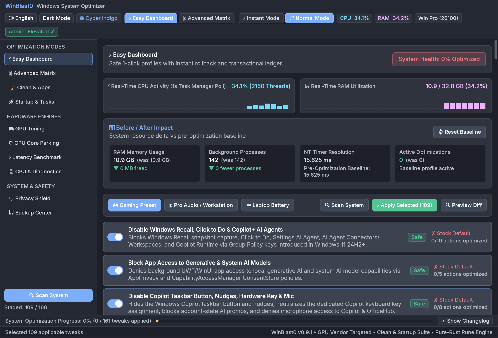

<div align="center">

# ⚡ WinBlast Optimizer

### Next-Generation, Pure-Rust Windows System Optimizer & Hardware Latency Engine

[](https://github.com/Konstrukturmx/WinBlast-Optimizer/releases/latest)
[-brightgreen?style=for-the-badge&logo=virustotal)](https://www.virustotal.com/gui/file/19895c54d3699391aebedb5c3e384aeb7ac5a73f8d1bee9ff7da4cd623d2fa00)
[](LICENSE)
[-0078D6?style=for-the-badge&logo=windows)](https://github.com/Konstrukturmx/WinBlast-Optimizer)
[](https://www.rust-lang.org/)
[-success?style=for-the-badge)](tests/)
[](src/core/tweak_i18n/)

<p align="center">
  <b>WinBlast Optimizer</b> is a standalone, lightweight, zero-dependency Windows optimization suite designed for performance enthusiasts, competitive gamers, power users, and system administrators. Built in pure Rust with direct Win32/NT kernel bindings, it replaces bloated PowerShell scripts and black-box tweakers with an auditable, transactional, and fully reversible optimization engine.
</p>

[**Download Latest Release (v0.9.1)**](https://github.com/Konstrukturmx/WinBlast-Optimizer/releases/latest) • [**Changelog**](CHANGELOG.md) • [**Architecture Guide**](DEVELOPMENT.md) • [**VirusTotal Report (v0.9.0 build)**](https://www.virustotal.com/gui/file/19895c54d3699391aebedb5c3e384aeb7ac5a73f8d1bee9ff7da4cd623d2fa00) • [**Documentation Vault**](WinBlast0/)

---

</div>

## 📸 Interface Preview

<div align="center">

### 🚀 Easy Dashboard (One-Click Profiles & Live Hardware Telemetry)


<br/><br/>

### 🎛️ Advanced Optimization Matrix (168 Curated Tweaks)


<br/><br/>

### ⚡ CPU Core Parking & Hybrid Architecture Visualizer


<br/><br/>

### 🎮 GPU Silicon Tuning & Hardware Vendor Gating


</div>

---

## 🌟 Key Architecture & Capabilities

Derived from the formal [**WinBlast0 Technical Knowledge Base**](WinBlast0/00%20-%20Index%20(MOC).md), WinBlast Optimizer is engineered with four fundamental pillars:

### 1. 🦀 Pure-Rust Rune Engine & Zero-Lag GUI
* **GPU-Accelerated Rendering**: Custom immediate-mode Rune GUI with hardware V-Sync synchronization and fluid 60 FPS spring animations.
* **Responsive Layout Tiers**: Dynamic adaptation across all monitor resolutions (from 720p laptops to 4K ultra-wide displays) with automatic mobile/compact navigation drawer mode.
* **Themed Always-On Scroll Bars**: Every overflowing viewport renders a custom palette-driven scroll bar (6 pt muted thumb at rest, 9 pt theme-accent thumb on hover/drag) instead of following Windows' hide-until-scrolling default.
* **Invisible Subprocesses**: All external system calls use `CREATE_NO_WINDOW` (`0x08000000`) and standard descriptor nulling — zero command prompt flashing or flickering.
* **Dark / Light & Chromatic Themes**: 4 WCAG AA compliant theme schemes (*Cyber Indigo*, *Midnight Stealth*, *Emerald Mint*, *Crimson Sunset*).

### 2. 🛡️ Dual-Layer Transactional Rollback & Safety
* **SQLite WAL Transaction Ledger**: Every change made by the optimizer is atomically written to a local SQLite Write-Ahead Logging (`winblast0_ledger.db`) database recording previous registry values, service configurations, and power settings.
* **1-Click Deep Revert**: Undo any single tweak or restore complete system baselines with one click.
* **VSS System Restore Point Integration**: Automatic creation of native Windows Volume Shadow Copy restore points before applying high-impact configuration waves.

### 3. ⏱️ NT Kernel Telemetry & Microsecond Latency Suite
* **Native Kernel Telemetry**: Replaces high-overhead WMI queries with direct `NtQuerySystemInformation(SystemProcessorPerformanceInformation)` deltas, providing accurate per-core active vs. idle percentages with zero CPU overhead.
* **High-Precision Timer Resolution**: Direct `NtQueryTimerResolution` / `NtSetTimerResolution` FFI kernel interfacing to monitor sub-millisecond OS tick jitter (down to 0.500 ms).
* **DPC / ISR Micro-Jitter Probe**: Real-time measurement of Deferred Procedure Call interrupt jitter using `QueryPerformanceCounter` (QPC).
* **Anycast DNS Latency Tester**: Concurrent multi-threaded TCP/ICMP ping tester comparing latency against Tier-1 global resolvers (Cloudflare, Google, Quad9).

### 4. 🧠 Intelligent Hardware & CPU Core Parking Engine
* **Dynamic Core Unparker**: Dynamically unlocks clamped Windows power profile ranges (`CPMINCORES` / `CPMAXCORES`) before modifying values, resolving `Win32 error 0x0000000D (13)`.
* **Hybrid P-Core / E-Core Awareness**: Reads `GetLogicalProcessorInformationEx` processor topology to classify Performance cores and Efficiency cores on modern Intel (12th-14th Gen) and AMD Ryzen processors.
* **GPU Vendor Gating**: Auto-probes active graphics adapters via `SetupDiGetDeviceInstanceIdW` and DXGI, safely locking vendor-exclusive tweaks (e.g., AMD ULPS/ASPM vs NVIDIA Dynamic P-States) to prevent driver crashes.
* **PCIe Message Signaled Interrupts (MSI)**: Enforce low-latency line-based interrupt migration to vector-based MSI mode for discrete GPUs and audio controllers.

---

## 🌐 Full-Stack Internationalization (i18n)

WinBlast features zero hardcoded strings. Every title, description, category, service token, scanner detail message, and error code is dynamically translated at runtime:

| Flag | Language | Status | Native Name |
| :---: | :---: | :---: | :---: |
| 🇬🇧 | **English** | 100% | English |
| 🇹🇷 | **Turkish** | 100% | Türkçe |
| 🇩🇪 | **German** | 100% | Deutsch |
| 🇫🇷 | **French** | 100% | Français |
| 🇪🇸 | **Spanish** | 100% | Español |
| 🇷🇺 | **Russian** | 100% | Русский |
| 🇨🇳 | **Chinese** | 100% | 简体中文 |
| 🇯🇵 | **Japanese** | 100% | 日本語 |

*Includes diacritic-insensitive search folding (`I18n::fold_search_str`) supporting dotted/dotless `i/ı` and German umlauts.*

---

## 📚 Declarative Tweak Catalogs (168 Audited Tweaks)

The optimizer features **168 validated declarative optimizations** indexed across 10 TOML catalogs with multi-axis risk assessments (`Safe`, `Low`, `Moderate`, `High`):

| Catalog | Focus & Description |
| :--- | :--- |
| **`bloatware_appx.toml`** | Deprovisioning of non-essential preinstalled UWP packages (Bing News, Weather, Clipchamp, Cortana, Solitaire, etc.) using clean 4-store registry indexing without slow PowerShell overhead. |
| **`privacy.toml`** | Telemetry elimination: advertising IDs, activity histories, timeline tracking, diagnostic data collection, Windows Customer Experience Improvement Program (CEIP), and location tracking. |
| **`registry_lag.toml`** | Kernel scheduler and I/O optimizations: `Win32PrioritySeparation`, `NetworkThrottlingIndex`, `SystemResponsiveness`, NTFS 8.3 name generation disablement, NTFS last access timestamps, and 1:1 mouse smoothing. |
| **`hardware_tuning.toml`** | PCIe Message Signaled Interrupts (MSI), GPU interrupt prioritization, High-Precision Event Timer (HPET) tuning, and compositor settings. |
| **`os_settings.toml`** | Windows 11 AI deactivation: Recall AI screen analysis indexer, Copilot flyouts, Bing Start Menu web searches, Consumer Cloud Content, and lockscreen Spotlight advertisements. |
| **`perf_power_ext.toml`** | Power throttling override, dynamic tick disablement, paging executive enforcement in RAM, and Ultimate Performance power scheme initialization. |
| **`telemetry_apps.toml`** | Third-party background telemetry deactivation (Office telemetry, Google Chrome update reporters, NVIDIA telemetry container, Visual Studio feedback). |
| **`telemetry_os.toml`** | Background Windows services hardening (`DiagTrack`, `dmwappushservice`, `WerSvc` Windows Error Reporting, `RemoteRegistry`). |
| **`ai_privacy_ext.toml`** | Deep Copilot+ Recall privacy protections, Windows Ink workspace tracking, speech model data harvesting, and device diagnostics. |
| **`ux_customization.toml`** | Explorer responsive tweaks: classic context menu restoration, show file extensions, hide 3D Objects / OneDrive folders, and disable taskbar search clutter. |

---

## 🛡️ Security & VirusTotal Transparency

Because WinBlast Optimizer adjusts low-level system settings, Windows Registry parameters, and hardware power states, transparency and security are paramount.

* **Target Binary**: `winblast0.exe` (v0.9.1)
* **File Size**: `28,935,680` bytes (27.6 MB)
* **SHA-256 Checksum**:
  ```text
  145b454ea49c010a9384fa361f29905515f4b4268418f9e10ffee76f8e9003f8
  ```
* **VirusTotal Scan Result (v0.9.0 build)**: [**View Official VirusTotal Report**](https://www.virustotal.com/gui/file/19895c54d3699391aebedb5c3e384aeb7ac5a73f8d1bee9ff7da4cd623d2fa00)
  * **Detection Score**: 69 / 75 engines confirmed completely undetected/clean.
  * **Note on Heuristics**: The sole generic detection (`Wacatac.B!ml`) is Microsoft Defender's automated machine-learning (`!ml`) heuristic flag typical for newly compiled, unsigned Rust binaries modifying Windows service/registry endpoints. The full source code is provided in this repository for independent verification.

---

## 🛠️ Building & Verification

### Prerequisites
* Windows 10 (Build 19041+) or Windows 11 (all builds including 24H2).
* [Rust Toolchain](https://rustup.rs/) (stable channel, 2021 edition).
* Administrator elevation (required for kernel registry and service adjustments).

### Build Commands
```powershell
# Clone repository
git clone https://github.com/Konstrukturmx/WinBlast-Optimizer.git
cd WinBlast-Optimizer

# Check codebase and dependencies
cargo check --all-targets

# Run the complete test suite (105 tests)
cargo test

# Compile optimized release binary
cargo build --release
```

The resulting standalone executable will be placed at:
```text
target\release\winblast0.exe
```

---

## 🧪 Comprehensive Quality Assurance & Test Matrix

WinBlast Optimizer includes an exhaustive test suite verifying safety across real and virtualized environments:

| Test Suite | Coverage & Validation Focus | Results |
| :--- | :--- | :---: |
| **`cargo test --lib`** | Core i18n tables (8 languages), NT timer resolution, CPU topology classification, power range unlock, scanner logic, and risk valuation. | **72 / 72 PASS** |
| **`tweak_sandbox_e2e`** | Isolated mock registry & file trees, worker panic recovery, partial mutation failure rollback, epoch scan fencing, and concurrent transactions. | **18 / 18 PASS** |
| **`ui_responsive_e2e`** | Headless DOM tree verification, multi-resolution viewport sweeps (720p to 4K), theme switching, and multi-locale layout stress testing. | **8 / 8 PASS** |
| **`ui_scrollbar_test`** | Headless E2E scroll-bar geometry, hover-widening, and drag/wheel-scroll interaction across every main view and the sidebar. | **4 / 4 PASS** |
| **`real_windows_env`** | Live host read-only audit, Win32 registry type round-trips, and safe NTFS junction cleanups. | **3 / 3 PASS** |
| **Total Automated Tests** | **Zero failures, zero panics, zero warnings** | **105 / 105 PASS** |

---

## 📄 License

This project is licensed under the open-source **[MIT License](LICENSE)**.

---

<div align="center">
  <sub>Built with ❤️ in Rust for high-performance Windows computing.</sub>
</div>
