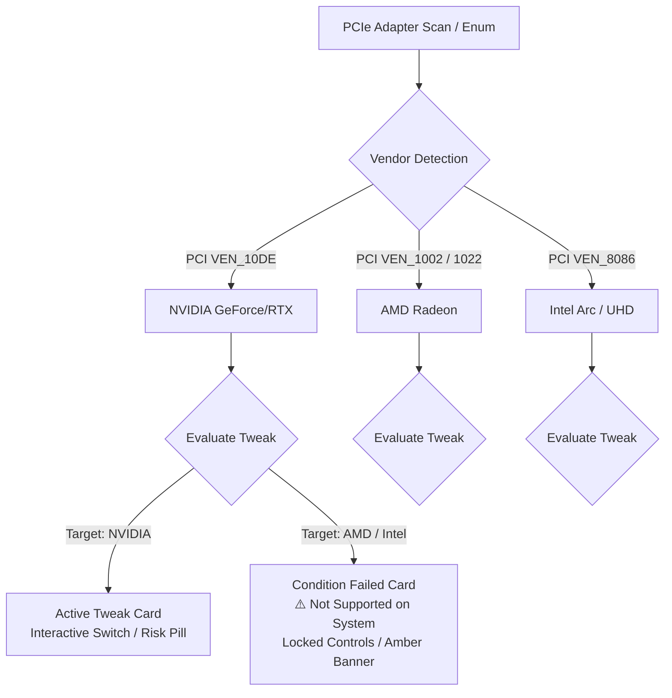

# GPU Low-Level Tuning & Vendor Targeting

## 1. Executive Overview
WinBlast0 v0.4.0 introduces a dedicated **GPU Tuning** subsystem designed to optimize graphics card latency, interrupt dispatching, frame presentation pipelines, and vendor-specific silicon features.

To prevent system instability or corrupted registry state resulting from applying vendor-incompatible tweaks, WinBlast0 performs **hardware-level silicon vendor scanning** at startup and enforces **conditional locking** on any tweak targeting silicon not present in the host system.

---

## 2. Hardware Vendor Detection Logic
Display adapters are enumerated via the Windows Registry display class:
`SYSTEM\CurrentControlSet\Control\Class\{4d36e968-e325-11ce-bfc1-08002be10318}`

Silicon vendor classification is established through a dual-stage heuristic:
1. **PCI Hardware Vendor ID (VEN_xxxx)**:
   - `VEN_10DE`: **NVIDIA Corporation**
   - `VEN_1002` / `VEN_1022`: **Advanced Micro Devices (AMD)**
   - `VEN_8086`: **Intel Corporation**
2. **Driver Description Fallback**:
   - Matches driver strings such as `GeForce`, `RTX`, `Radeon`, `Arc`, `UHD Graphics`.

---

## 3. Conditional Incompatibility Presentation
When a tweak specifies a `gpu_vendor` requirement that is not met by the host's detected display adapters:
- The UI renders an **Incompatible Card** styled with:
  - Header: `⚠️ Not supported on this system`
  - Subtitle: Unique Tweak UUID (e.g., `4433ce93-b632-4d67-ae71-0241c31099c0`)
  - Title: Bold feature name (e.g., `Disable AMD ULPS`)
  - Warning Inset:
    - `⚠️ Condition failed`
    - `{Vendor} GPU required`
    - `This item only works on systems with an {Vendor} graphics card.`
  - Dimmed visual opacity and locked interactions.

When the tweak matches the host's GPU (e.g., NVIDIA on an RTX system):
- The UI renders an **Active Interactive Card** featuring:
  - Unique Tweak UUID
  - Feature title and silicon category badge (`[NVIDIA] [Silicon]`)
  - Detailed architectural description
  - Risk rating badge (`Safe`, `Caution`, `Low Risk`)
  - Live system state (`Active ✔`, `Stock ✘`)
  - Animated toggle switch
  - Granular code diff preview button (`< / >`)

---

## 4. Consolidated GPU Architecture Features
In addition to vendor silicon cards, the dedicated GPU tab consolidates:
1. **PCIe Message Signaled Interrupts (MSI)**:
   - Eliminates IRQ pin sharing bottlenecks by assigning dedicated PCIe MSI vectors.
   - Per-device priority level configuration (Low, Normal, High).
2. **Hardware-Accelerated GPU Scheduling (HAGS)**:
   - Direct VRAM scheduling offload from CPU to GPU scheduler (`HwSchMode = 2`).
3. **Multi-Plane Overlay (MPO) Stutter Mitigation**:
   - Disables DWM hardware composition plane switching to prevent frame drops in mixed refresh rate setups (`OverlayTestMode = 5`).

---

## 5. Catalog of Vendor Optimizations

### AMD Radeon
| Tweak UUID | Title | Target Registry Key | Effect |
| :--- | :--- | :--- | :--- |
| `4433ce93-b632-4d67-ae71-0241c31099c0` | Disable AMD ULPS | `EnableUlps = 0` | Eliminates Ultra Low Power State wake-up micro-stutter in 3D gaming |
| `8a4b4c4d-000e-42db-8bd7-293067f8fae7` | Disable AMD ASPM | `ASPMDisabled = 1` | Prevents PCIe Active State link down-shifting during frame gaps |
| `a3836587-c461-4beb-9c4c-88493b36c138` | Disable AMD Power Gating | `EnablePowerGating = 0` | Sustains continuous compute unit clocks across fluctuating loads |
| `db379bb5-fc8c-4ad3-be32-11be09e76fba` | Disable AMD Video Clock Gating | `EnableVideoClockGating = 0` | Prevents display engine clock drops to eliminate DPC frame presentation spikes |

### Intel Arc / Graphics
| Tweak UUID | Title | Target Registry Key | Effect |
| :--- | :--- | :--- | :--- |
| `df8739ff-e322-4958-b369-df584bb9b0c1` | Disable Intel Async Flips | `AsyncFlips = 0` | Disables asynchronous page flips for deterministic VSYNC presentation intervals |
| `ebfb0ded-5d1a-4cd1-b5c0-4f7018dd6054` | Disable Intel Adaptive V-Sync | `AdaptiveVsync = 0` | Prevents driver refresh throttling when framerate dips below display refresh |

### NVIDIA GeForce / RTX
| Tweak UUID | Title | Target Registry Key | Effect |
| :--- | :--- | :--- | :--- |
| `fa58802f-b98c-4e98-aa67-067c5a394296` | Disable NVIDIA Dynamic P-State | `DisabledDynamicPstate = 1` | Locks NVIDIA GPU into fixed performance state, eliminating clock speed drops |
| `9e7702be-9e03-4c96-a316-c4e435cb993e` | Disable NVIDIA Async P-States | `DisableAsyncPstates = 1` | Prevents asynchronous power state switching for deterministic VR/real-time frametimes |
| `5f1a2b3c-4d5e-6f7a-8b9c-0d1e2f3a4b5c` | Enable NVIDIA Max Performance PowerMizer | `PowerMizerEnable = 1` | Enforces peak PCIe bus and memory controller frequencies on AC power |
