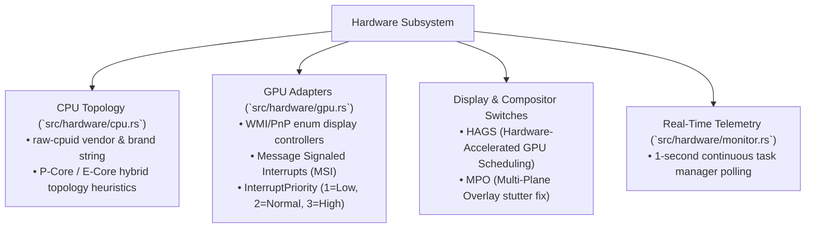

# 🎮 Hardware & GPU Low-Level Tuning Architecture

WinBlast0 interfaces directly with Windows hardware abstraction layers, registry drivers, and CPUID instruction sets to configure interrupt routing, GPU compositor scheduling, and processor topology.

---

## 🏛️ Subsystems Overview

---

## ⚡ 1. PCIe Message Signaled Interrupts (MSI Mode)

### The Problem:
Traditional legacy devices communicate with the CPU via **Line-Based Interrupts (INTx)**. Multiple PCIe devices (e.g. GPU, NVMe controller, sound card) frequently share the same physical IRQ line. When the GPU signals an interrupt, the OS kernel must poll every device on that shared line, causing micro-stutters, DPC latency spikes, and frametime jitter.

### The MSI Solution:
**Message Signaled Interrupts (MSI / MSI-X)** assign a dedicated in-band PCIe memory write packet to each device. Interrupts are delivered directly to the CPU without shared IRQ line contention.

In `src/hardware/gpu.rs`:
- Detects PCIe graphics adapters via `Win32_VideoController` and registry enumeration under `SYSTEM\CurrentControlSet\Enum\PCI\...`.
- Reads `Device Parameters\Interrupt Management\MessageSignaledInterruptProperties\MSISupported`.
- Configures interrupt affinity and priority via `Device Parameters\Interrupt Management\Affinity Policy\DevicePriority`:
  - `1` = `Low`
  - `2` = `Normal`
  - `3` = `High` (Prioritizes GPU rendering interrupts over non-realtime peripherals)

---

## 🖥️ 2. Hardware-Accelerated GPU Scheduling (HAGS)

Windows 10/11 includes Hardware-Accelerated GPU Scheduling, which offloads high-frequency scheduling tasks from the CPU to a dedicated GPU scheduling processor.

In `src/hardware/gpu.rs`:
- Hive: `HKLM`
- Key: `SYSTEM\CurrentControlSet\Control\GraphicsDrivers`
- Value: `HwSchMode`
  - `2` = **Enabled** (Accelerated scheduling active)
  - `1` = **Disabled** (CPU software scheduling fallback)

WinBlast0 exposes a 1-click toggle with immediate reboot requirement alerts.

---

## 🪟 3. Multi-Plane Overlay (MPO) Stutter Fix

### The Problem:
Multi-Plane Overlay allows desktop window manager (DWM) planes to be composited directly by GPU hardware without a full desktop copy. On modern NVIDIA, AMD, and Intel GPUs on Windows 11, bugged driver implementations cause black screens, cursor hitching, Discord/Chrome flickering, and VRR micro-stutters.

### The Fix:
- Hive: `HKLM`
- Key: `SOFTWARE\Microsoft\Windows\Dwm`
- Value: `OverlayTestMode`
  - `5` = **Disabled** (Forces standard composition, permanently fixing MPO stutters)
  - `0` / absent = **Default**

---

## 🧠 4. Hybrid CPU Topology Detection (Intel P/E Cores)

Located in `src/hardware/cpu.rs`:
- Uses the `raw-cpuid` crate to query Intel/AMD leaf registers.
- Inspects physical core count via `sysinfo::System::physical_core_count()`.
- Calculates hybrid P-core (Performance) and E-core (Efficiency) distribution using the heuristic:
  $$\text{logical} = p \times 2 + e \quad \text{and} \quad \text{physical} = p + e$$
  $$\Rightarrow p = \text{logical} - \text{physical}, \quad e = 2 \times \text{physical} - \text{logical}$$
- Displays exact core topology and per-core real-time utilization graphs.

---

## 🔗 Related Notes
- [[Real-Time Task Manager Monitoring]]
- [[Registry Lag & Kernel Scheduling]]
- [[00 - Index (MOC)]]
