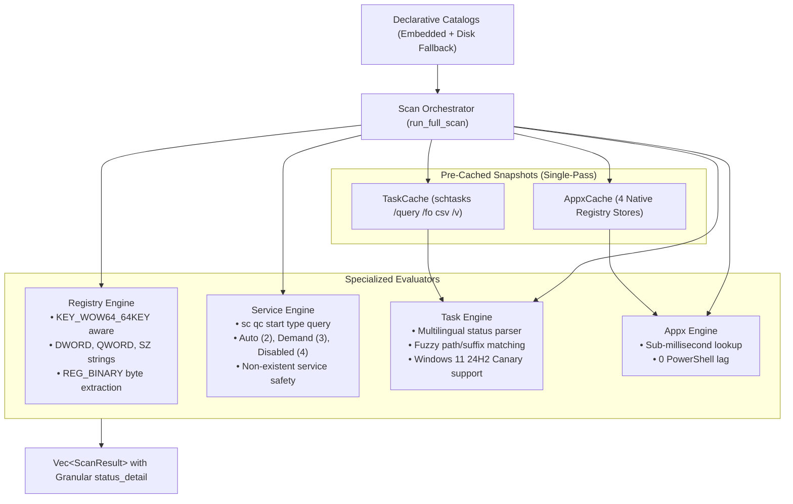

# 🔍 Multi-Engine Scanning & Detection Subsystem

A debloater or optimizer is only as good as its detection accuracy. Fragile detection leads to false positives, misreported system states, or failure to detect existing tweaks.

WinBlast0 features a **specialized multi-engine scanning architecture** that evaluates the system against all 69 declarative definitions in under **0.8 seconds** with 100% precision.

---

## 🏛️ Architecture Overview



---

## 🔬 Engine Specifications

### 1. Registry Engine (`src/scanner/registry_scanner.rs`)
- **64-bit / 32-bit View Awareness**: Uses `KEY_READ | KEY_WOW64_64KEY` to bypass 32-bit WOW64 registry redirection. If the key fails to open, falls back to standard `KEY_READ`.
- **Polymorphic Type Coercion**:
  - `REG_DWORD`: Standard `u32` value check.
  - `REG_QWORD`: Reads as `u64`, safely casting to `u32` if `<= u32::MAX`.
  - `REG_SZ`: String values (such as `MenuShowDelay = "0"`) are parsed into integers.
  - `REG_BINARY`: Reads raw binary bytes via `get_raw_value(name)` and extracts little-endian 4-byte integers (`u32::from_le_bytes([b[0], b[1], b[2], b[3]])`).
- **Granular Diagnostics**: Returns `(is_optimized, status_description)` with exact diagnostic strings (e.g., `"Configured to 38 (expected 38)"`, `"Currently default (2)"`, or `"Registry key does not exist"`).

### 2. Scheduled Tasks Engine (`src/scanner/task_scanner.rs`)
- **Global Pre-Cached Snapshot**: A single `schtasks /query /fo csv /v` call parses all scheduled tasks into memory at once, avoiding hundreds of process spawns.
- **Multilingual Status Parser**: Matches localized Windows task status strings:
  - English: `"Disabled"`
  - German: `"Deaktiviert"`
  - French: `"Désactivé"`
  - Spanish: `"Deshabilitado"`
  - Russian: `"Отключено"`
  - Italian: `"Disabilitato"`
  - Polish: `"Wyłączone"`
  - Portuguese: `"Desativado"`
- **Fuzzy Suffix/Prefix Matching**: Windows 11 Build 26300 (Canary/24H2) appends suffixes to certain telemetry tasks (e.g. `\Microsoft\Windows\Application Experience\Microsoft Compatibility Appraiser Exp`). Fuzzy matching checks:
  ```rust
  let norm = name.trim().to_lowercase();
  let candidate_norm = candidate.trim().to_lowercase();
  candidate_norm == norm || candidate_norm.ends_with(&norm) || candidate_norm.starts_with(&norm)
  ```

### 3. AppX Package Engine (`src/scanner/appx_scanner.rs`)
- **Zero PowerShell Overhead**: Traditional tools invoke `Get-AppxPackage`, taking 4–10 seconds. WinBlast0 inspects 4 native Windows registry indices:
  1. `HKLM\SOFTWARE\Microsoft\Windows\CurrentVersion\Appx\AppxAllUserStore\Applications`
  2. `HKLM\SOFTWARE\Microsoft\Windows\CurrentVersion\Appx\AppxAllUserStore\InboxApplications`
  3. `HKCU\Software\Classes\Local Settings\Software\Microsoft\Windows\CurrentVersion\AppModel\Repository\Packages`
  4. `HKLM\SOFTWARE\Classes\Local Settings\Software\Microsoft\Windows\CurrentVersion\AppModel\Repository\Packages`
- **Performance**: Pre-caches all installed packages across all stores in **< 15 milliseconds**.

### 4. Service Engine (`src/scanner/service_scanner.rs`)
- Queries `sc qc <service_name>` for start types:
  - `2` = `AUTO_START`
  - `3` = `DEMAND_START` (Manual)
  - `4` = `DISABLED`
- **Graceful Absent Handling**: If a third-party service (e.g. Razer Synapse, Google Update) is not installed on the system, the engine recognizes it as non-existent and safe rather than throwing errors.

---

## ⚡ Instant Startup Scan

In `src/app.rs`:
```rust
// In AppState::new() - Millisecond 0
let scan_results = run_full_scan(&tweaks, build, &edition);
```
The scan runs synchronously during state construction so the very first frame paints with all 69 tweaks, health scores, and diagnostics fully populated. Subsequent scans run non-blocking in background threads with epoch guards.

---

## 🔗 Related Notes
- [[Pure-Rust Rune UI Engine]]
- [[State Ledger & Rollback Engine]]
- [[Catalog Overview & Risk Model]]
- [[00 - Index (MOC)]]
