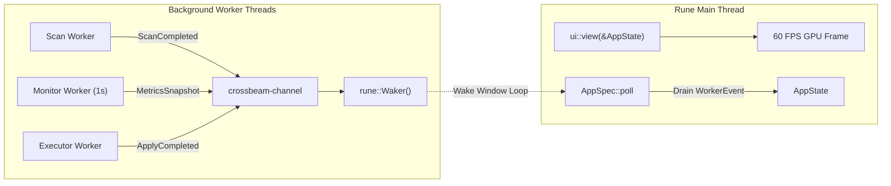

# 🖥️ Pure-Rust Rune UI Engine Architecture

WinBlast0 is built entirely on the **Rune framework** (`C:/Hive/rune-framework/crates/rune`), a native, GPU-accelerated desktop UI engine written in pure Rust.

Unlike Electron, Tauri, or WebView2 applications that carry a 150–300 MB Chromium runtime overhead and noticeable input latency, WinBlast0 compiles into a single, self-contained **24 MB native PE executable** that consumes under 40 MB of RAM and renders at a locked 60 FPS GPU refresh rate.

---

## 🏛️ Application State Machine (`AppState`)

Located in `src/app.rs`, `AppState` serves as the single source of truth for the reactive UI:



### Key Components:
- **`AppSpec` Lifecycle**:
  - `spec.setup`: Called on window initialization. Captures the window `Waker` and starts non-blocking warmup threads (catalog scan, restore point enumeration, 1-second monitoring loop).
  - `spec.poll`: Called on event loop cycles. Drains the crossbeam channel via `rx_events.try_recv()`, applying typed worker messages and returning `true` when a re-render is needed.
  - `ui::view`: Pure stateless function `(s: &AppState, cx: &mut Cx<AppState>) -> El` producing the element layout tree.

---

## ✨ 60 FPS Micro-Interactions & Hover Animations

WinBlast0 v0.2.0 features full GPU-accelerated spring animations across all interactive controls using Rune's motion engine:

### 1. Spring Switches (`switch_toggle`)
```rust
let knob = el()
    .size(16.0, 16.0)
    .radius(8.0)
    .fill(Color::WHITE)
    .absolute(if selected { 18.0 } else { 2.0 }, 2.0);

el()
    .size(36.0, 20.0)
    .radius(10.0)
    .fill(if selected { theme::ACCENT } else { theme::BG_PRIMARY })
    .hover(if selected { theme::ACCENT_HOVER } else { theme::BG_CARD_HOVER })
    .border(1.0, theme::BORDER)
    .motion(rune::tok::motion::SNAPPY)
    .child(knob)
    .on_press(move |s: &mut AppState| s.toggle_tweak(id.clone(), !selected))
```
When toggled, the switch knob springs smoothly across the track using physical spring dynamics (`SNAPPY`).

### 2. Interactive Buttons (`action_button` / `primary_button`)
All buttons feature tri-state reactive styling:
- **Rest State**: `fill(bg)`
- **Hover State**: `.hover(theme::ACCENT_HOVER)` (brightens and elevates border)
- **Press State**: `.press(theme::ACCENT_PRESS)` (subtle tactile depression)
- **Motion Spec**: `.motion(rune::tok::motion::SNAPPY)` ensures transitions glide rather than abruptly snapping.

### 3. Card Elevation & Hover Highlight
All cards (`header_card`, `item_card`, `before_after_card`, `sparkline`) carry `.hover(theme::BG_CARD_HOVER)` and `.motion(rune::tok::motion::SNAPPY)`. Moving the mouse through tweak lists gives clear, fluid spatial feedback.

---

## 🎨 Theme Tokens (`src/ui/theme.rs`)

| Token | Color (sRGB) | Role |
| :--- | :--- | :--- |
| `BG_PRIMARY` | `rgb(0.012, 0.014, 0.022)` | Window root canvas |
| `BG_SIDEBAR` | `rgb(0.018, 0.021, 0.032)` | Sidebar navigation panel |
| `BG_CARD` | `rgb(0.028, 0.033, 0.048)` | Card container surface |
| `BG_CARD_HOVER` | `rgb(0.045, 0.054, 0.078)` | Card elevation on pointer hover |
| `ACCENT` | `rgb(0.20, 0.42, 0.95)` | Electric Blue brand accent |
| `ACCENT_HOVER` | `rgb(0.28, 0.52, 1.0)` | Button pointer hover glow |
| `SUCCESS` | `rgb(0.15, 0.78, 0.42)` | Green (Safe, Optimized, Freed) |
| `WARNING` | `rgb(0.95, 0.65, 0.15)` | Amber (Moderate, Partial state) |
| `DANGER` | `rgb(0.92, 0.24, 0.28)` | Crimson (High risk, Default lag) |
| `SPARKLINE_CPU` | `rgb(0.20, 0.70, 0.95)` | Cyan waveform for CPU metrics |
| `SPARKLINE_RAM` | `rgb(0.85, 0.45, 0.95)` | Magenta waveform for RAM metrics |

---

## 🔗 Related Notes
- [[Real-Time Task Manager Monitoring]]
- [[State Ledger & Rollback Engine]]
- [[00 - Index (MOC)]]
