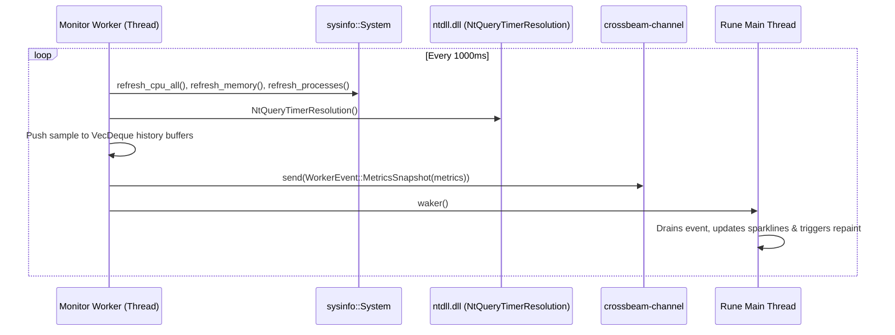

# ⚡ Real-Time Task Manager Monitoring & Telemetry

WinBlast0 v0.2.0 introduces continuous, **1-second Task Manager style real-time monitoring** designed to provide instantaneous visual feedback on system resource utilization before, during, and after optimization tweaks are applied.

---

## 🏛️ Architecture & Worker Loop

Located in `src/hardware/monitor.rs` and spawned during `AppState::setup`:



### Metrics Sampled Every Second:
- **Global CPU Utilization %**: Floating point overall utilization (`0.0% – 100.0%`).
- **Per-Core CPU Utilization %**: Individual core utilization for up to 64 cores/threads.
- **Physical RAM Utilization**: Total RAM (MB), Used RAM (MB), Available RAM (MB), and utilization percentage.
- **Active OS Processes**: Count of running Windows process identifiers.
- **Execution Threads**: Total count of active OS threads across all processes.
- **NT Kernel Timer Resolution**: Nanoseconds reported directly by the Windows NT kernel (e.g. `500,000 ns` = `0.500 ms`).

---

## 📈 Live Waveform Sparkline Widget (`src/ui/widgets/sparkline.rs`)

WinBlast0 draws hardware waveforms using native Rune GPU layout primitives (`el()`, `row()`, `col()`):

```rust
pub fn sparkline(
    title: &str,
    current_value_label: &str,
    history: &[f32],
    chart_color: Color,
    chart_height: f32,
    max_bars: usize,
) -> El
```

### Visual Characteristics:
- **Rolling History**: Keeps a rolling window of **30–35 samples** (representing the last 30–35 seconds of activity).
- **Physical Proportional Scaling**: Each micro-bar's height is proportional to the sampled percentage:
  `let bar_h = ((val / 100.0).clamp(0.02, 1.0) * chart_height).max(2.0);`
- **GPU Spring Motion**: Bars update with `.motion(rune::tok::motion::SNAPPY)`.
- **Dual Visualizers**:
  - **CPU Activity**: Graph in electric cyan (`SPARKLINE_CPU`).
  - **RAM Utilization**: Graph in vibrant magenta (`SPARKLINE_RAM`).

---

## ⏱️ NT Kernel Timer Resolution (`ntdll.dll`)

Standard Windows uses a default timer interrupt interval of **15.625 ms** (64 ticks/second). High-performance applications, competitive gaming, and audio DAWs require timer resolutions between **1.000 ms and 0.500 ms** (1,000 to 2,000 ticks/second) to eliminate scheduler queuing delay.

WinBlast0 dynamically binds to `ntdll.dll`:
```rust
#[link(name = "ntdll")]
extern "system" {
    fn NtQueryTimerResolution(
        minimum_resolution: *mut u32,
        maximum_resolution: *mut u32,
        current_resolution: *mut u32,
    ) -> i32;
}

pub fn query_nt_timer_resolution() -> u64 {
    let mut min_res = 0u32;
    let mut max_res = 0u32;
    let mut cur_res = 0u32;
    unsafe {
        if NtQueryTimerResolution(&mut min_res, &mut max_res, &mut cur_res) == 0 && cur_res > 0 {
            // cur_res is reported in 100-nanosecond units
            return (cur_res as u64) * 100;
        }
    }
    15_625_000 // Standard Windows fallback: 15.625 ms
}
```
This is displayed continuously in the top navigation ticker and in the Hardware diagnostic view.

---

## 🔗 Related Notes
- [[Pure-Rust Rune UI Engine]]
- [[Hardware & GPU Low-Level Tuning]]
- [[State Ledger & Rollback Engine]]
- [[00 - Index (MOC)]]
