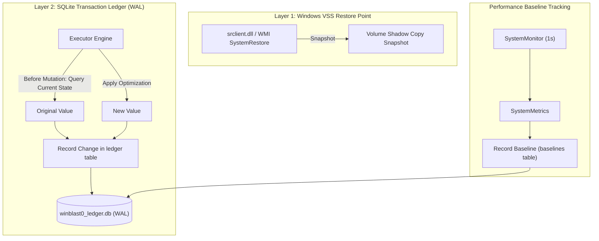

# 💾 State Ledger & Dual-Layer Rollback Engine

A fundamental architectural requirement of WinBlast0 is **reversibility without compromise**. Modifying low-level Windows registry keys, kernel scheduling algorithms, services, and scheduled tasks can create unexpected side-effects if not strictly tracked.

WinBlast0 implements a **dual-layer rollback architecture**:
1. **Layer 1: Windows Volume Shadow Copy (VSS) System Restore Points** (Full OS fallback).
2. **Layer 2: SQLite-Backed Atomic Transaction Ledger** (Granular, individual tweak undo).

---

## 🏛️ Architecture Overview



---

## 🗄️ Database Schema (`winblast0_ledger.db`)

The ledger operates in **Write-Ahead Logging (WAL)** mode with a **5-second busy timeout** to prevent lock contention between UI and worker threads:

```sql
PRAGMA journal_mode = WAL;
PRAGMA synchronous = NORMAL;

-- Tracks individual mutations for surgical rollback
CREATE TABLE IF NOT EXISTS ledger (
    id             INTEGER PRIMARY KEY AUTOINCREMENT,
    tweak_id       TEXT    NOT NULL,
    action_type    TEXT    NOT NULL,
    original_value TEXT    NOT NULL,
    new_value      TEXT    NOT NULL,
    timestamp      TEXT    NOT NULL,
    rolled_back    INTEGER NOT NULL DEFAULT 0
);

-- Tracks system resource benchmarks for Before / After impact
CREATE TABLE IF NOT EXISTS baselines (
    id                  INTEGER PRIMARY KEY AUTOINCREMENT,
    captured_at         TEXT    NOT NULL,
    total_ram_mb        INTEGER NOT NULL,
    used_ram_mb         INTEGER NOT NULL,
    process_count       INTEGER NOT NULL,
    thread_count        INTEGER NOT NULL,
    timer_resolution_ns INTEGER NOT NULL,
    optimized_count     INTEGER NOT NULL,
    label               TEXT    NOT NULL
);
```

---

## 🔄 Individual Rollback Mechanics

Located in `src/executor/engine.rs`:

```rust
pub fn rollback_entry(entry: &LedgerEntry, ledger: &StateLedger) -> Result<(), String> {
    match entry.action_type.as_str() {
        "RegistryDword" => {
            // Parses target hive, subkey path, and value name safely
            // Writes entry.original_value back to registry
        }
        "ServiceState" => {
            // Restores Windows service start type to default (Auto/Manual/Disabled)
        }
        "ScheduledTask" => {
            // Re-enables or disables task via schtasks /change
        }
        _ => return Err(format!("Unsupported action type: {}", entry.action_type)),
    }

    // Atomically marks record as rolled back
    ledger.rollback_entry(entry.id).map_err(|e| e.to_string())
}
```

### Edge Case Guard:
In v0.2.0, single-slash root keys (e.g. `HKLM\ValueName`) are specifically checked to prevent `slice index starts after end` panics during path decomposition.

---

## 📊 Before & After Impact Tracking

The ledger captures an **Initial System Baseline** upon the very first scan before any tweaks are modified. Whenever tweaks are applied or rolled back, a **Post-Optimization Baseline** is logged.

The UI compares real-time metrics with the initial baseline to compute:
- **RAM Memory Saved**: `baseline.used_ram_mb - current.used_ram_mb`
- **Processes Eliminated**: `baseline.process_count - current.process_count`
- **Timer Resolution Delta**: `baseline.timer_resolution_ns` vs `current.timer_resolution_ns`
- **Net Optimization Gain**: `current.optimized_count - baseline.optimized_count`

---

## 🔗 Related Notes
- [[Pure-Rust Rune UI Engine]]
- [[Multi-Engine Scanning Subsystem]]
- [[Debugging & Edge Cases Resolved]]
- [[00 - Index (MOC)]]
