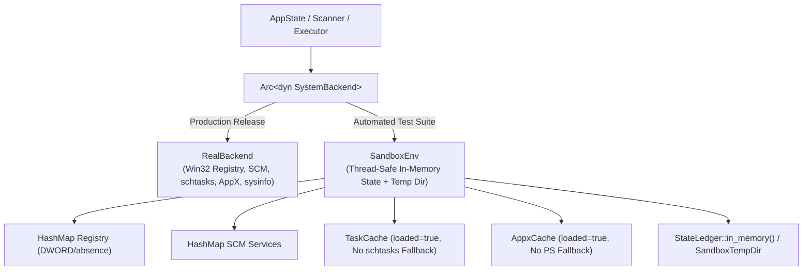

# 🧪 SystemBackend & Isolated Tweak Sandbox Environment (v0.6.0)

## 1. Architecture Overview

To verify all **99 declarative tweaks**, rollback ledger semantics, and background worker lifecycles in parallel `cargo test` runs **without mutating the developer's host Windows OS**, WinBlast0 v0.6.0 abstracts all OS sensing and mutation calls behind the object-safe [`SystemBackend`](file:///c:/Hive/Projects/WinBlast0/src/core/backend.rs) trait:

---

## 2. Sandbox Design (`SandboxEnv`)
- **Zero Host Leakage**:
  - `SandboxEnv` implements `SystemBackend` using `Arc<RwLock<SandboxState>>` paired with an RAII `Arc<SandboxTempDir>` for SQLite `.db` and `.wb0` profile files.
  - `TaskCache::from_map(..., loaded=true)` and `AppxCache::from_packages(...)` (`loaded=true`) prevent accidental subprocess spawning (`schtasks` / `powershell`) even when the sandbox store becomes empty after uninstalling bloatware.
  - Fault-injection hook (`inject_next_error: Option<String>`) deterministically simulates mid-execution failures to prove `in_flight_tweaks` lock release in Instant Mode.
- **In-Memory SQLite Ledger**:
  - `StateLedger::in_memory()` uses `Connection::open_in_memory()`, allowing parallel round-trip tests to verify ledger writes and rollbacks at microsecond speed.

---

## 3. Core Execution & Win32 Engine Fixes Discovered During E2E Testing
1. **AppX PackageFamilyName Targeting**: Fixed `ps_runner::remove_appx_package` and `appx_scanner::check_package_removed_ps` to filter `$_.PackageFamilyName -eq $pf` with `-AllUsers` and `Remove-AppxProvisionedPackage`, plus strict `__{pub_id}` publisher suffix matching.
2. **Service Control Manager (`sc config`) Sync**: Updated `svc_mutator::set_service_start_type` to synchronize in-memory SCM start types alongside `KEY_WOW64_64KEY` registry writes, eliminating Error 1058 when restarting reverted services.
3. **OEM Console Decoding & Multilingual Tasks**: Integrated Win32 `MultiByteToWideChar(CP_OEMCP)` in `task_scanner.rs` + localized `"Disabled"` tokens for Turkish (`Devre Dışı`), Russian, German, French, Spanish, Chinese, and Japanese. Replaced ambiguous prefix matching with exact + explicit space-suffix (`Exp`) matching.
4. **Absent Pre-State Sentinel (`__ABSENT__`)**: `engine::apply_tweak_with` records `__ABSENT__` when a key/service/task did not exist pre-apply; `rollback_entry_with` deletes created registry values (`reg_delete_value`) and cleanly skips non-existent services/tasks instead of crashing.
5. **Known Windows `REG_SZ` Preservation & Optimus GPU Subkey Resolution**: `reg_mutator::set_dword` writes decimal `REG_SZ` strings for native Windows string settings (`MenuShowDelay`, `MinAnimate`, `AutoEndTasks`, `MouseSpeed`, etc.) even if unconfigured, and `hardware::gpu::resolve_gpu_class_path` dynamically selects discrete NVIDIA/AMD subkeys on multi-GPU laptops.
6. **Hosts Comment Skipping**: `ps_runner::block_telemetry_hosts_in_content` reuses `parse_blocked_hosts_from_content` so `#` comments and superstrings do not trigger false skips.
7. **Catalog Conflict & Value Type Reconciliation**: Reconciled overlapping targets (`NtfsDisableLastAccessUpdate`, `WerSvc`, `MMCSS`, Cortana, Bing Search, consumer features, feedback tasks) and fixed `enable_game_mode` (`default_value = 0`), `PowerSchemes\...\AcSettingIndex`, `TdrDelay`, and `ListviewAlphaSelect`/`ListviewShadow` (removing `REG_BINARY` overwrite on `UserPreferencesMask`).
