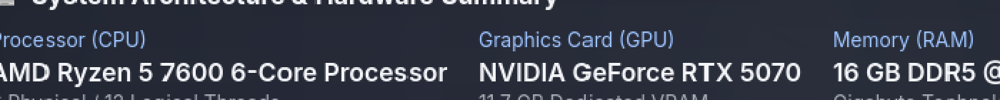
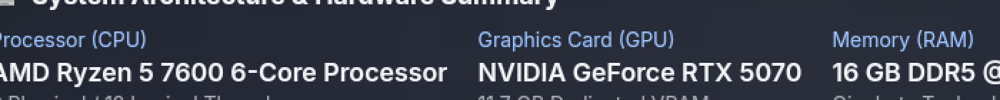
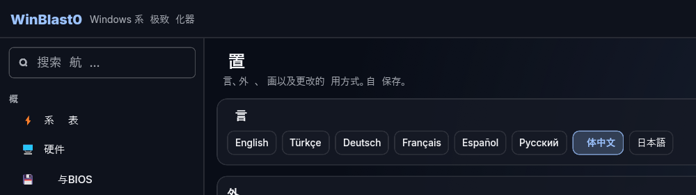
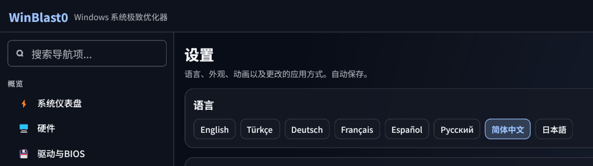

# Text engine: before and after (2026-11-25, this PC, 125 % display scaling)

| | Before | After |
|---|---|---|
| A card under the mouse (cards scale to 101.2 % on hover) |  "Proces sor": letters snapped one by one, gaps open up |  even spacing, one straight baseline |
| Chinese UI |  设置 → 置, 系统 → 系, 语言 → 言 |  every character present |

Captured with the screenshot tour: `WINBLAST_SCREENSHOT_DIR`, `WINBLAST_SCREENSHOT_HOVER=700,660`,
`WINBLAST_TEXT_RENDER=classic|sharp` and `WINBLAST_SETTINGS_PATH` pointing to a settings file
with `"language": "Chinese"` (the Chinese "before" image is from the build before Noto Sans SC was
embedded).
